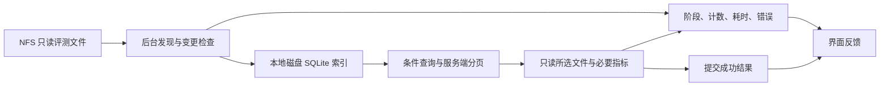

# 工作台改造：加载诊断与交互原型

这是修复前的诊断与设计交付。它不替换现有 Streamlit 应用，不安装依赖，也不声称已解决真实 NFS 目录的性能问题。运行环境仍为 Python 3.8.18 / Streamlit 1.40.1 / streamlit-aggrid 1.0.5。

## 先查看交互

Windows 解压后，双击 **workbench.html**，用 Edge 或 Chrome 打开。它不需要 Python、不需要启动服务器、不访问网络。页面显式标注模拟数据，内置 6 个实验、12 个 checkpoint；加载时长和故障均为演示。

可以直接操作：

- 输入关键词：立即显示“待应用”；提交后显示执行阶段，成功后才更新当前筛选标签、结果数与表格。
- 更新期间取消或切换“读取失败”：旧结果仍可查看；失败可查看诊断和重试。
- 切换正常、加载、空结果、错误四种状态；空结果提供清空条件入口。
- 打开任意实验右侧详情、查看模拟趋势、比较固定基线，或导出当前模拟结果 CSV。
- 切换 PNC、BEV、Depth：指标、单位、改善方向同步改变。

视觉采用低干扰导航、紧凑筛选区和占据主体的数据表；颜色用于状态和指标改善。加载状态不是遮住整页的转圈，错误也不会清空已经看见的结果。原型用来审查这些行为，不是已接通 NFS 的成品。

## 在现有 Linux 服务器诊断

将 **diagnose_loading.py** 放到服务器本地目录。使用运行面板的同一个 Python 3.8 环境，替换下面的数据根目录；`--pattern` 填面板当前任务实际读取的文件名，BEV 示例为 `bev_det_kof.json`。

```bash
python diagnose_loading.py --root "/实际/评测结果根目录" --pattern bev_det_kof.json --output /tmp/loading-report.json
```

无需安装包。默认时间预算 45 秒，最多枚举 10000 个目录 / 200000 个条目，抽样读取最多 6 个不超过 8 MiB 的文件。父进程每秒显示阶段、目录数、匹配文件数与标记检查次数。超时或 Ctrl+C 会保存已经得到的统计，而不是一直等待。

报告包含数量、字节数、Python / 依赖版本、文件系统类型、阶段耗时与错误类型 / errno；**不包含数据路径、实验名、关键词或 JSON 业务值，不上传任何数据**。脚本读取源目录，报告写在源目录以外；输出目录应当是本地磁盘，不能是指向源目录的软链接。已有报告不会覆盖，再次运行请换一个输出文件名。

NFS 系统调用可能处于 Linux 不可中断 I/O 状态。父进程能停止等待并保存报告，操作系统仍可能延迟结束工作进程；脚本不会因此无限等待，也不宣称能强制立刻解除 NFS 阻塞。

和当前面板对齐的筛选参数：

```bash
python diagnose_loading.py --root "/实际/评测结果根目录" --pattern bev_det_kof.json --keyword "实验关键词" --all-checkpoints --output /tmp/loading-filtered-report.json
```

默认取每个实验最新 checkpoint；`--all-checkpoints` 取普通实验全部 checkpoint，STAR / SUN 基线仍仅最新。`--keyword` 可重复，按 OR 匹配；默认保留基线，`--no-keep-baselines` 可关闭。诊断覆盖当前加载器的两种目录结构：

```text
根目录/实验名@60000/bev_det_kof.json
根目录/实验名/eval/iter_60000/bev_det_kof.json
```

还兼容 `根目录/实验名/结果.json`。脚本会报告根目录直接含结果文件、遇到软链接、没有匹配、单文件或总量预算命中等情况。为复现当前加载策略，它统计但不跟随软链接；这不是未来实现应忽略软链接的决定。

## 如何读报告

| 字段 / 发现 | 含义 |
| --- | --- |
| `status: partial` | 超时、数量限制、取消或文件系统错误；计数不是完整目录总量 |
| `selection.would_current_loader_reject_all: true` | 已完成的发现范围触发现有整批拒绝规则；正常小文件也会被排除 |
| `SYMLINKS_PRESENT_AND_SKIPPED_BY_CURRENT_LAYOUT_POLICY` | 发现被当前目录策略跳过的软链接，需核查真实布局 |
| `RESULT_FILES_AT_ROOT_CURRENT_LOADER_DOES_NOT_INCLUDE` | 根目录层级可能填写得过深 |
| `timings.directory_enumeration` | 目录枚举总耗时 / 调用数 / 最大单次耗时 |
| `timings.flag_exists_checks` | 标记文件存在性检查耗时 |
| `timings.sample_file_read` | 有上限的抽样读取耗时，含读取前后的一致性检查 |
| `timings.sample_json_decode_and_parse` | 抽样 JSON 解码与解析耗时 |
| `errors` | 按操作、异常类型、errno 聚合，不暴露原始异常文本 |

这些计时属于受限诊断，不等同于面板总耗时或 NFS 网络往返次数。脚本会复用目录标记检查，未重复面板所有冗余操作，也不测浏览器渲染。未清理操作系统缓存；不能用二次运行的缓存效果宣称真实提速。单个文件的抽样解析失败会记入报告，不妨碍其他样本继续检查。

请把生成的 JSON 统计报告发回当前对话，用于判断真实失败属于目录布局、预算拒绝、权限、NFS 元数据访问还是 JSON 读取 / 解析。不要将真实报告提交到公开 GitHub 仓库。

## 已确认的问题与改造顺序

详见 [AUDIT.md](AUDIT.md)。已用当前代码复现整批预算拒绝、软链接静默跳过、过深根目录无结构提示，以及筛选前全量扫描等问题。这些是代码事实；是否就是实际 NFS 加载失败的原因，需要报告验证。

下一步以一个真实 BEV 工作流落实下列路径，之后再扩展任务类型：



索引只放本地磁盘，跨页面共享；新扫描完成前继续使用上一完整批次。普通筛选查索引，不重新扫描整棵 NFS 目录。刷新只使变化文件失效；单文件失败单独报告。后台工作不直接操作 Streamlit UI。导出和趋势读取都先限定所需实验与 checkpoint。

验收必须覆盖真实根目录首次发现、缓存查询、刷新、软链接、坏文件、大文件、取消和读取失败；记录首个可见结果、目录调用数、读取量与内存。尚未采集这些真实指标，不预设提速倍数。

## 本地验证

2026-11-10 验证结果：Python 3.8.18 下 16 项诊断测试、8 项现有缺陷特征测试全部通过。离线 Chromium 验证了筛选计数、待应用条件、取消、失败查询重试、索引与结果时间、空状态、任务指标切换、详情、CSV、导航，以及 390 px 宽度下无整页横向溢出；没有 JavaScript 异常或外部网络请求。此结果不包含真实 NFS 性能测试。

诊断脚本测试只依赖 Python 标准库：

```bash
python -m unittest discover -s tests -p test_diagnostic.py -v
```

`tests/test_loading_regressions.py` 则依赖被审计的现有项目及其依赖。这是缺陷特征测试，**通过表示成功复现缺陷，不代表修复完成**；目录设置和运行方式见 AUDIT.md。真实业务数据不在此交付中。
