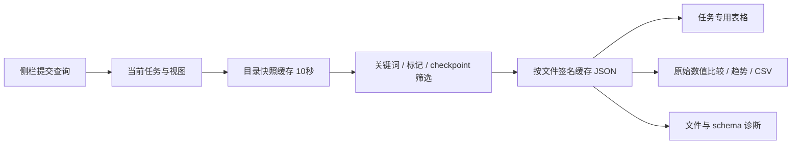

# 实验性能追踪：Streamlit 优化版

这份实现针对上传的 2,214 行面板源码进行了可运行的重构，保留 GOD、COG、BEV、PNC、PVSeg、Depth、Navi、BEV-new 八类任务。重点是正确展示评测结果、降低交互读取成本，以及提供明确的基线比较与错误诊断。引用的 ChatGPT 对话仅提供了摘要，其中两份 brief 和完整分析未能取得；本文不把缺失内容当作已确认需求。

## 启动

当前版本适配 **Python 3.8.18 + Streamlit 1.39.0 / 1.40.1 + streamlit-aggrid 1.0.5**。在已有 Conda 环境中运行，不需要创建新环境或升级 Python。

```bash
cd /path/to/leaderboard_new
python -m streamlit run app.py --server.fileWatcherType=poll
```

请从项目根目录启动，让 `.streamlit/config.toml` 生效。运行入口是优化版的 `app.py`，原版 `leaderboard/main.py` 不会使用本项目的兼容层。

已有可用依赖时无需重新安装。`requirements.txt` 列出 Python 3.8 的兼容范围；`requirements-tested.txt` 记录验证用版本，只在缺少依赖或需要复现测试时安装。不存在 Streamlit 1.67、AgGrid 1.1.8、NumPy 2 或 Pandas 2.2 的要求。

源码包不含评测数据。首次启动可点击「生成模拟演示数据」，生成 3 个实验、各 3 个 checkpoint 试用；也可执行 `python scripts/generate_demo.py`。生成器只写入指定的 `demo_data/`，拒绝覆盖没有模拟标识的非空目录。

本版以兼容的水平 radio 切换任务；所有撑满容器的控件使用 `use_container_width=True`，下载回调使用旧版支持的参数，字体配置为 `sans serif`，文件监视采用 `poll`。

`dashboard/compat.py` 在项目内修正 AgGrid 1.0.5 的异常类引用，保留上游的数据转换与表格组件。无需编辑 Conda 环境里的 `st_aggrid/__init__.py`；Streamlit 的 Stop/Rerun 控制信号会正常透传，真实组件错误仍报告原始异常。

接入真实结果：

```bash
DASHBOARD_DATA_ROOT=/path/to/evaluation_root streamlit run app.py
```

也可在侧栏选择「本地目录」，填写路径，再点「应用筛选」。路径是 **Streamlit 服务端**可访问的目录。应用不修改真实实验、标记和评测文件。

## 页面如何使用

1. 左侧一次提交数据源、关键词、最新 checkpoint 和置顶偏好。关键词是包含匹配，多个词取 OR；留空或 `ALL` 展示全部。
2. 「任务指标」保留各任务的专用指标选择器、距离/IoU、组合指标格式和标记置顶。列名提示说明：组合单元格按首个显示数值排序。
3. 「基线对比」选择文件、原始指标路径和具体基线 checkpoint。保持数值列，显示绝对差及相对变化，支持 CSV。只有主动选择指标方向后才显示改善/退化；切换指标后恢复为仅显示差值。
4. 「Checkpoint 趋势」读取匹配实验的历史 checkpoint。每次最多选择 12 个实验，不插值伪造评测点，缺失值保留断点。此页明确独立于全局「仅最新」。
5. 「训练速度」每行输入 `名称 | 日志路径`，支持本地日志文件、Rank-0 日志目录、训练输出目录及 OBS。按需流式读取，用有效区间耗时的中位数汇总。
6. 查看底部诊断可以定位坏 JSON、写入中的文件、schema 缺字段和重复来源。原始 JSON 只有勾选后才序列化展示。

默认 STAR/SUN 为基线并置顶；可选择其他标记。关键词过滤时保留基线/置顶是显式开关；HIDE 始终排除。最新文件损坏时会跳过并说明原因，不静默显示旧 checkpoint 冒充最新。

Cookie 组件已移除。运行状态保存在当前会话中，刷新浏览器后的恢复可使用「将当前筛选写入分享链接」。链接只携带任务、关键词、仅最新和置顶标记；目录和其他偏好不在链接内。「导出视图配置」保存全部已提交设置为 JSON，当前未实现配置导入。

## 数据目录约定

兼容上传代码的扁平缓存布局，以及原始实验目录布局：

```text
evaluation_root/
  baseline/STAR
  baseline@60000/
    pnc_eval.json
    param.json               # 可选
  candidate@60000/
    pnc_eval.json
```

```text
evaluation_root/
  baseline/
    STAR
    param.json               # 可选
    eval/
      iter_60000/
        pnc_eval.json
        param.json           # 可选，覆盖实验级同名字段
```

也支持 `root/experiment/result.json`，其 iteration 为 0。文件名沿用原代码，例如 `god_eval.json`、`cog_eval.json`、`bev_det.json`、`pnc_eval.json`、`pvseg_rslt.json`、`depth_eval.json`、`navi_eval.json`。

元数据采用明确约定：实验目录或 checkpoint 目录的 `job_config.json`、`param.json`。同层 `param.json` 优先，checkpoint 层优先于实验层；`romaDetailUrl` 用作任务链接，且只接受 HTTP(S)。上传源码访问的 `ExpEvalObj.param_json` 没有定义，无法推断生产环境实际元数据位置；若真实目录不同，修改 `dashboard/data.py` 的 `_metadata_directories()` 与候选文件名即可。缺少元数据不会丢弃评测结果。

标记支持 STAR、SUN、GALAXY、FLAG、APPLE、GRAPE、SAKURA、STAR2 和 HIDE。扫描固定目录层级，不遍历整个实验树，不跟随实验/结果文件的符号链接。同一目录同时混放两种布局并产生重复 `(experiment, iteration, filename)` 时，冲突记录会被排除并诊断。

## 结构与性能



| 文件 | 职责 |
|---|---|
| `app.py` | 页面、表单、比较、趋势、诊断、按需展示原始结果 |
| `dashboard/data.py` | 只读扫描、标记筛选、稳定 JSON 读取、元数据 |
| `dashboard/cache.py` | 有 TTL 与条目上限的 Streamlit 数据缓存 |
| `dashboard/context.py` | 每次重跑独立的上下文、查询预算、表格和导出 |
| `dashboard/domain.py` | 八类原有任务指标适配与控件 |
| `dashboard/analytics.py` | 原始数值展开、差值和零基线处理 |
| `dashboard/training.py` | 流式日志解析与训练速度统计 |
| `dashboard/compat.py` | AgGrid 1.0.5 异常捕获兼容，不修改已安装包 |

优化后的查询先选择实验和 checkpoint，再读取内容。JSON 缓存键包含绝对路径、`mtime_ns`、大小和刷新版本；变化的文件使用新键。目录快照缓存 10 秒，JSON 缓存 300 秒/2,048 条，训练日志缓存 60 秒/32 条。到期后在下一次交互更新，不是后台轮询。手动刷新仅为本会话生成新的缓存版本，不清空所有用户缓存。

JSON 读取前后校验文件属性和 inode；文件被替换、持续写入或不是严格 JSON 时返回诊断。异常不被缓存为成功数据。单次评测查询限制 2,000 文件、单文件 16 MiB、合计 128 MiB，超过时提示缩小筛选，不静默截断。日志使用流式行读取，单次累计 128 MiB 上限；时间戳索引仍与有效迭代数成比例。多份 Rank-0 轮转文件合并，相同 iteration 使用最新时间戳。OBS 使用延迟导入的 moxing，不在启动或重跑时改认证设置。

表格的浏览器排序/过滤不触发 `MODEL_CHANGED` 服务端往返；CSV 按已提交的数据筛选生成，包含置顶行，不跟随浏览器里临时的列过滤。原代码已经通过 pills 条件分发只运行当前任务，新版保留这一点，未将其描述为新修复。

## 已修复的结果问题

| 原源码问题 | 本版行为 |
|---|---|
| 未定义 `param_json` 后吞掉异常 | 独立读取可选元数据，不影响有效指标 |
| BEV 按递增位置取距离值 | 使用 `dist_thres` 的真实下标；兼容整数/字符串阈值 |
| 缺指标时缩短整行 | 固定占位，避免后续指标错列 |
| 跨实验字典顺序影响列对应 | 按列名对齐，动态字段取并集 |
| PV 类别顺序与固定表头不一致 | 按 `cls` 映射数组到类别列 |
| GOD Obstacle 缺项被当作 0m | 保持缺失；真实零值仍为零 |
| `timedelta.seconds` 截断跨天时长 | 使用 `total_seconds()`；忽略非正耗时 |
| 全局参数注入与共享速度缓存写文件 | 每会话闭包/上下文；只读、有界缓存 |
| Cookie 值未经校验、每次重跑写 Cookie | 当前会话状态与受校验的链接参数 |
| 未指定方向即可能误解指标提升 | 默认只比较数值，方向由用户选择 |
| TensorBoard 空关键词可匹配全部并删除目录 | 移除源目录删除路径；改用只读趋势查看 |

通用数值比较只使用原始 JSON 数字，不把 `12/30`、`FDE30/FDE50` 等字符串猜成比值。数组路径按下标对齐，页面明确要求使用相同 schema、距离定义和单位；专用 BEV 表则依据距离阈值匹配。PNC Average 沿用原来各场景可用值的算术均值，并非按样本加权。

## 验证与本地基准

```bash
python -m pip install 'pytest==8.3.5'
python scripts/generate_demo.py
python -m pytest -q
python benchmarks/benchmark_io.py --output benchmark_results.json
```

测试覆盖数据布局、预筛选、坏文件隔离、签名变化、距离乱序、缺失列、类别顺序、零基线、复合字符串排除、跨天日志、流式预算、重复来源，以及真实 Streamlit 的 8 任务 × 3 视图、任务切换和方向重置。`COMPATIBILITY.md` 记录目标环境验证；下面的历史基准来自此前 Python 3.12 的性能样本，不是本次 Python 3.8 兼容性测速。

本地基准使用 50 实验 × 20 checkpoint、共 1,000 JSON（约 19.56 MB），关键词命中一个实验，取最新 checkpoint：

| 查询流程 | 文件打开 / JSON 解析 | 单次耗时 |
|---|---:|---:|
| 全量解析后筛选 | 1,000 / 1,000 | 628.490 ms |
| 先筛选后解析 | 1 / 1 | 137.041 ms |
| 文件签名字典缓存模拟 | 0 / 0 | 116.967 ms |

这是同环境的单次合成样本；非生产环境测速，也不是冷磁盘 I/O 测试。两种流程共用稳定 JSON reader，热缓存项为字典模拟，并非 Streamlit `st.cache_data` 的实测。基准脚本每次仍扫描目录，不代表应用目录缓存命中后的完整浏览器响应时间。页面性能数字仅统计当次服务端处理，不包括浏览器和网络。

## 迁移边界

- 原源码的 Whitelist 没有完整的表格字段解析。本版能检查其原始 JSON 和数值字段，专用表等待真实 schema；不会填入臆测公式。
- 原 TensorBoard 导出不保留。新版提供 Plotly 历史趋势；若需要原生 events 文件，后续应实现独立导出目录及后台作业。
- 未提供 `eval_and_vis_bev_model.py`，外部逐帧可视化模块未集成。
- 本次用模拟 schema 与回归样例验证，尚未连接真实评测目录或 OBS 账户。生产接入需用各任务真实样本核对字段、元数据位置和单位。
- 本版没有新增标记写回、账户权限、数据库、后台索引或任务队列。它适合在既有内部部署与认证环境中替换展示层。大规模目录若扫描成为主要耗时，应将 `scan()` 替换为后台增量索引查询；当前前端查询接口可继续使用。

本版没有发布网站或连接外部业务系统。解压后可先以演示模式运行，再配置真实目录。
